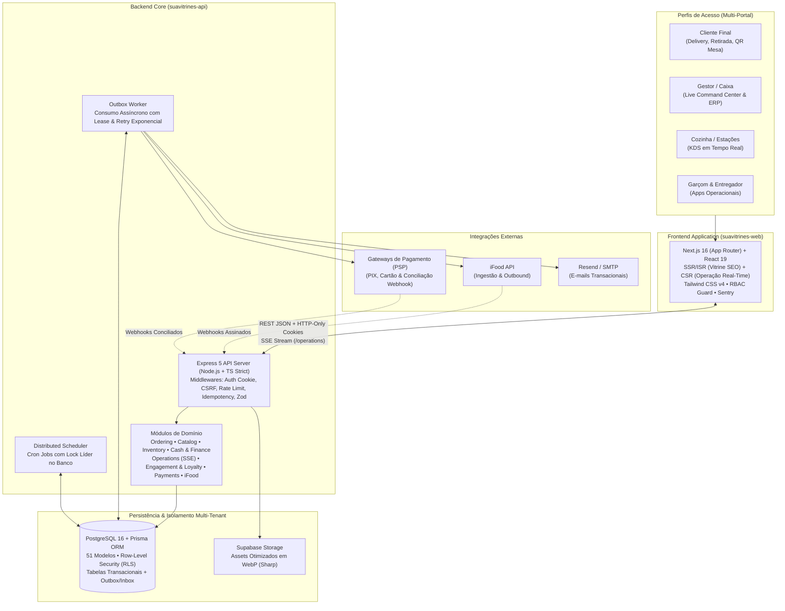

# Ciboo (SuaVitrines Food) — Engineering Showcase & Plataforma SaaS

> **Plataforma SaaS Multi-tenant de Gestão Gastronômica, Cardápio Digital de Alta Conversão e Operação em Tempo Real.**  
> Construída para empoderar restaurantes, operações de delivery e dark kitchens com tecnologia de ponta, autonomia de marca e **zero taxas abusivas de comissionamento**.

---

## Sobre Este Repositório

Este repositório público cumpre dois propósitos estratégicos dentro do ecossistema **Ciboo**:

1. **Engineering Showcase & Case Study Técnico**: Documentação aberta da arquitetura de software, decisões de engenharia (ADRs), padrões de segurança multi-tenant, confiabilidade transacional e métricas de qualidade que sustentam os repositórios privados de produção (`suavitrines-api` e `suavitrines-web`).
2. **Landing Page Oficial do Produto**: Base da aplicação web institucional e comercial de divulgação do **Ciboo / SuaVitrines Food**.

> **Nota sobre Propriedade Intelectual**: O código-fonte operacional do motor transacional (`suavitrines-api`) e da plataforma multi-portal (`suavitrines-web`) permanece em repositórios privados. Aqui compartilhamos de forma transparente a arquitetura real, modelagem de alto nível, fluxos sistêmicos e padrões de engenharia adotados.

---

## Navegação Rápida da Documentação Técnica

| Documento | Conteúdo Principal |
| :--- | :--- |
| **[Arquitetura de Sistemas (`docs/architecture.md`)](./docs/architecture.md)** | Topologia do sistema, separação de responsabilidades (MVC + Domain Modules), fluxo de eventos em tempo real (SSE), *Transactional Outbox/Inbox* e *Distributed Scheduler*. |
| **[Segurança & Multi-Tenancy (`docs/security-and-multitenancy.md`)](./docs/security-and-multitenancy.md)** | Isolamento de dados com *PostgreSQL Row-Level Security (RLS)*, autenticação via *HTTP-Only Cookies*, proteção CSRF/SSRF, RBAC granular e criptografia de segredos em repouso. |
| **[Decisões de Engenharia / ADRs (`docs/engineering-decisions.md`)](./docs/engineering-decisions.md)** | Idempotência com hash canônico, aritmética monetária estrita em centavos, máquina de estados determinística de pedidos, reserva de estoque com ficha técnica e Feature Flags. |
| **[Módulos do Produto (`docs/product-modules.md`)](./docs/product-modules.md)** | Detalhamento funcional das jornadas: Vitrine Mobile-First, Live Command Center, KDS por Estações, Catálogo Multicanal, Frente de Caixa, CRM/Fidelidade e Integração iFood. |

---

## Visão Geral da Arquitetura

O ecossistema **Ciboo** é dividido em serviços desacoplados e orientados a domínio, garantindo baixa latência para a vitrine pública de vendas e alta confiabilidade para a operação interna de cozinha, caixa e estoque:

---

## Stack Tecnológica Principal

### Backend (`suavitrines-api`)
- **Runtime & Linguagem**: Node.js (ES Modules) + TypeScript 6 (`strict: true`)
- **Framework HTTP**: Express 5 com arquitetura **MVC + Módulos de Domínio**
- **Banco de Dados & ORM**: PostgreSQL 16 + Prisma ORM (51 modelos relacionais e políticas nativas de *Row-Level Security*)
- **Validação & Contratos**: Zod (validação em todas as fronteiras HTTP e variáveis de ambiente na inicialização)
- **Segurança**: Autenticação JWT via **Cookies HTTP-Only**, `bcryptjs`, `helmet`, proteção CSRF, proteção SSRF em webhooks, validação binária de uploads (`file-type` + `sharp`) e criptografia simétrica para credenciais sensíveis de terceiros
- **Processamento Assíncrono**: *Transactional Outbox Pattern* nativo em PostgreSQL (`OutboxWorker`) e *Distributed Lock Scheduler* (`node-cron` + locks atômicos)
- **Testes**: Vitest (30 suítes cobrindo regras de negócio, isolamento multi-tenant, concorrência, máquina de estados e segurança)

### Frontend (`suavitrines-web`)
- **Framework**: Next.js 16 (App Router) + React 19 + TypeScript (`strict: true`)
- **Estilização & UI**: Tailwind CSS v4, `lucide-react`, `recharts` (analytics executivo), `sonner`
- **Operação em Tempo Real**: Server-Sent Events (SSE) com controle de cursor (`Last-Event-ID`) e fallback inteligente de polling
- **Observabilidade**: Sentry (`@sentry/nextjs`) integrado nas camadas Client, Server e Edge
- **Testes**: Vitest + React Testing Library (24 suítes de componentes e fluxos) + Playwright (3 suítes End-to-End completas)

---

## Módulos do Produto & Jornadas Operacionais

O **Ciboo (SuaVitrines Food)** cobre de ponta a ponta a jornada operacional e comercial de um restaurante moderno. Expanda cada módulo abaixo para visualizar suas funcionalidades práticas:

<strong>1. Vitrine Digital Mobile-First & Checkout em 2 Etapas</strong>

 

A vitrine pública (`/[slug]`) foi construída com foco em taxa de conversão e velocidade de carregamento:

- **Identidade Visual por Loja**: Cores da marca, logotipo, banner de capa, selo de status (Aberto/Fechado em tempo real conforme horário de funcionamento), tempo médio estimado de entrega/retirada e avaliações verificadas.
- **Navegação com Scrollspy e Busca Instantânea**: Barra de categorias fixa que acompanha a rolagem da página, seção de produtos em destaque (*Featured*) e modal/bottom-sheet de produto com seleção intuitiva de variações e grupos de complementos (mínimo/máximo obrigatórios).
- **Checkout Enxuto em 2 Etapas**:
  1. **Identificação e Modalidade**: Suporte nativo a **Delivery** (com cálculo automático de taxa por bairro), **Retirada no Balcão** e **Consumo no Local / Mesa via QR Code** (preenchimento automático do número da mesa via parâmetro `?table=`).
  2. **Pagamento e Confirmação**: PIX, Cartão, Dinheiro (com cálculo de troco), aplicação de cupons promocionais e resgate de pontos da carteira de fidelidade.
- **Live Order Tracker**: Página dedicada de acompanhamento do pedido ao vivo com barra de progresso em tempo real, resumo dos itens e PIN de segurança para recebimento da entrega.

<strong>2. Live Command Center (Central de Pedidos ao Vivo)</strong>

 

O coração da operação de balcão e expedição (`/admin/live`):

- **Visão Unificada Multicanal**: Recebe em uma única tela os pedidos vindos da Vitrine Digital própria, dos Garçons no salão, do QR Code das mesas e da integração **iFood**.
- **Alertas Sonoros e Monitoramento de SLA**: Destaque visual para novos pedidos pendentes de aceite e indicadores de tempo decorrido para evitar atrasos na expedição.
- **Ações Rápidas em 1 Clique**: Aceitar pedido, avançar para preparo, despachar com atribuição de entregador e imprimir comanda térmica (58mm/80mm).

<strong>3. KDS (Kitchen Display System) por Estações de Preparo</strong>

 

A tela de cozinha (`/admin/kitchen`) substitui comandas de papel perdidas por um fluxo digital sincronizado via **Server-Sent Events (SSE)**:

- **Roteamento por Praça/Estação**: Os itens de um mesmo pedido podem ser distribuídos automaticamente para suas respectivas estações (ex.: *Chapa/Cozinha Quente*, *Pizzaria/Forno*, *Bar/Bebidas*, *Sobremesas*).
- **Controle Granular por Item e por Pedido**: Os operadores da cozinha visualizam observações em destaque (ex.: *"Sem cebola"*), variações e complementos, marcando itens como *Em Preparo* ou *Pronto* com atualização imediata no Command Center e no portal do garçom.

<strong>4. Catálogo Multicanal & Gestor de Cardápio Digital</strong>

 

No módulo `/admin/menu`, o restaurante gerencia sua oferta comercial com agilidade:

- **Pausa Rápida (86ing)**: Esgotou um item no meio do turno? O gestor pausa ou reativa produtos e complementos instantaneamente com um clique.
- **Precificação e Disponibilidade por Canal**: Permite configurar preços e disponibilidades diferenciadas entre o canal próprio (Vitrine Web / Salão) e canais externos (Marketplaces / iFood), protegendo a margem de lucro do restaurante.
- **Sincronização Inteligente**: Detecção de *diffs* (divergências) entre o catálogo interno e o catálogo publicado em canais externos.

<strong>5. Estoque, Insumos & Ficha Técnica (Receitas)</strong>

 

O módulo `/admin/inventory` conecta as vendas diretamente ao custo de mercadoria vendida (CMV):

- **Cadastro de Insumos**: Controle em gramas (`g`), quilogramas (`kg`), mililitros (`ml`), litros (`l`) ou unidades (`un`), com custo médio e alerta de estoque mínimo.
- **Ficha Técnica de Produtos**: Associação de cada prato/bebida aos seus ingredientes e quantidades exatas consumidas por venda.
- **Baixa e Estorno Automáticos**: A confirmação de um pedido deduz automaticamente os insumos correspondentes; o cancelamento estorna os insumos com rastreabilidade completa no histórico de movimentações.

<strong>6. Hub Financeiro & Frente de Caixa (Turnos de PDV)</strong>

 

No módulo `/admin/financial`, o restaurante mantém controle rigoroso sobre o fluxo de caixa diário:

- **Gestão de Turnos de Caixa (`CashShift`)**: Abertura de caixa com fundo de troco inicial, registro de suprimentos (entradas), sangrias (retiradas) e fechamento cego/auditado com apuração automática de quebras ou sobras por meio de pagamento.
- **Gestão de Despesas Operacionais**: Lançamento e categorização de contas pagas (fornecedores, embalagens, motoboys, utilidades).
- **Conciliação e Resumo Financeiro**: Visão consolidada de receitas brutas, taxas de meios de pagamento, descontos concedidos, despesas e margem operacional.

<strong>7. CRM Gastronômico, Fidelidade & Conformidade LGPD</strong>

 

Ferramentas pensadas para transformar compradores ocasionais em clientes recorrentes (`/admin/marketing` & `/admin/loyalty`):

- **Programa de Fidelidade Nativo**: Configurável por loja (pontos por real gasto e regras de resgate), apoiado em um livro-razão (*ledger*) auditável.
- **Segmentação de Audiência e Campanhas**: Identificação de clientes VIPs, clientes inativos (*churn risk*) e aniversariantes/recorrentes para ações direcionadas.
- **Gestão de Consentimento LGPD**: Registro transparente de *opt-in* e *opt-out* de comunicações de marketing e termos de privacidade por cliente.

<strong>8. Portais Operacionais Dedicados (Garçom & Entregador)</strong>

 

- **Portal do Garçom (`/service`)**: Interface mobile ágil para atendimento de mesas no salão, permitindo abrir/fechar mesas, adicionar novos itens a uma comanda aberta e enviar pedidos direto para as estações do KDS.
- **Portal do Entregador (`/delivery`)**: Painel enxuto para a equipe de motoboys visualizar suas entregas em rota, acionar navegação GPS/WhatsApp do cliente e validar a entrega com o código PIN de confirmação.

<strong>9. Relatórios Executivos & Painel Super Admin SaaS</strong>

 

- **Analytics do Restaurante (`/admin/dashboard`)**: KPIs de faturamento, ticket médio, volume de pedidos por canal e horário, produtos campeões de venda e métricas de tempo de preparo.
- **Governança SaaS (`/super-admin/*`)**: Painel exclusivo para a administração da plataforma Ciboo gerenciar todas as lojas ativas, planos de assinatura, vencimentos e ativação seletiva de *Feature Flags*.

---

## Destaques de Engenharia

### 1. Isolamento Multi-Tenant em Profundidade (Defense-in-Depth)
Em um SaaS que gerencia dados financeiros e fiscais de múltiplos restaurantes, um filtro `WHERE storeId = ?` esquecido jamais pode causar vazamento entre lojas. O Ciboo implementa isolamento em duas camadas:
- **Camada de Aplicação**: Middlewares extraem o `storeId` exclusivamente da sessão autenticada (nunca confiando no payload do cliente) e propagam o contexto de ator (`ActorContext`).
- **Camada de Banco de Dados (PostgreSQL RLS)**: Políticas de *Row-Level Security* garantem no nível do motor SQL que uma transação escopada para um tenant não consiga ler ou modificar registros de outra loja.

### 2. Integridade Monetária e Máquina de Estados de Pedidos
- **Zero Ponto Flutuante em Finanças**: Cálculos de pedidos, descontos de cupons, taxas de entrega por bairro, turnos de caixa e conciliação de pagamentos operam em **centavos inteiros**, eliminando erros de arredondamento IEEE 754.
- **Zero Confiança no Preço do Cliente**: No checkout público, o backend ignora qualquer valor enviado pelo frontend e recalcula integralmente os preços dos produtos, variações, adicionais obrigatórios/opcionais, regras de cupom e taxa de entrega diretamente do banco de dados.
- **Transições Determinísticas**: Uma máquina de estados formal valida cada mudança de status do pedido (`PENDING` → `CONFIRMED` → `PREPARING` → `READY` → `DISPATCHED` → `DELIVERED` / `CANCELLED`), registrando trilha de auditoria (`OrderStatusHistory`) e disparando efeitos colaterais transacionais (baixa/estorno de estoque e eventos KDS).

### 3. Idempotência Canônica de Ponta a Ponta
Redes móveis instáveis frequentemente geram cliques duplos ou retentativas no momento do checkout e de pagamentos.
- A API implementa um motor de idempotência (`Idempotency-Key`) com **serialização JSON canônica** e hash criptográfico SHA-256 do payload.
- Requisições repetidas com a mesma chave retornam a resposta original cacheada sem duplicar pedidos, cobranças ou movimentações de estoque, enquanto reutilizações da mesma chave com payloads divergentes são bloqueadas com `409 Conflict`.

### 4. Ficha Técnica, Reserva de Estoque e Cálculo de CMV
- Produtos do cardápio podem ser vinculados a **Fichas Técnicas (Receitas)** compostas por múltiplos insumos em unidades de medida específicas (`g`, `ml`, `un`).
- Ao confirmar um pedido, o estoque é reservado/baixado de forma atômica e idempotente; em caso de cancelamento, o estorno de insumos ocorre automaticamente no livro-razão de movimentações (`InventoryMovement`).

### 5. Tempo Real Resiliente para Cozinha (KDS) e Balcão
- A comunicação entre o checkout, os garçons, a cozinha (KDS dividido por estações como *Chapa*, *Bar*, *Confeitaria*) e o painel do caixa ocorre via **Server-Sent Events (SSE)** apoiado por um `OperationChangeLog` sequencial.
- Caso a conexão de rede do restaurante oscile, o cliente reconecta enviando o último cursor recebido e sincroniza apenas o delta de alterações perdidas, sem recarregar a página.

---

## Indicadores de Qualidade do Projeto

| Métrica | Valor Atual |
| :--- | :--- |
| **Modelos de Dados (Prisma / PostgreSQL)** | **51 tabelas** modeladas com integridade referencial e índices otimizados |
| **Suítes de Teste no Backend (`suavitrines-api`)** | **30 suítes** (Unidade, Integração, RLS, Idempotência, Concorrência e Contratos) |
| **Suítes de Teste no Frontend (`suavitrines-web`)** | **24 suítes** (Componentes, RBAC, Fluxos Operacionais) + **3 suítes E2E (Playwright)** |
| **Cobertura de Tipagem** | **100% TypeScript Strict** em ambos os repositórios (`tsc --noEmit`) |
| **Validação de Runtime** | **100% dos endpoints** validados via schemas **Zod** e envelope padronizado |

---

## Contato & Demonstração

Para conhecer mais sobre a plataforma **Ciboo / SuaVitrines Food** ou agendar uma demonstração técnica detalhada do código-fonte privado, entre em contato.
