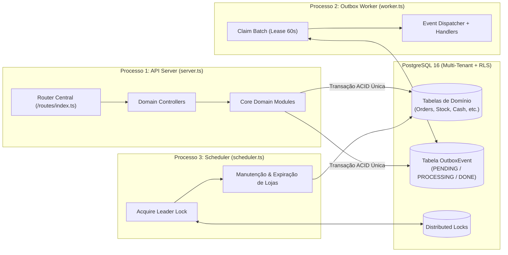
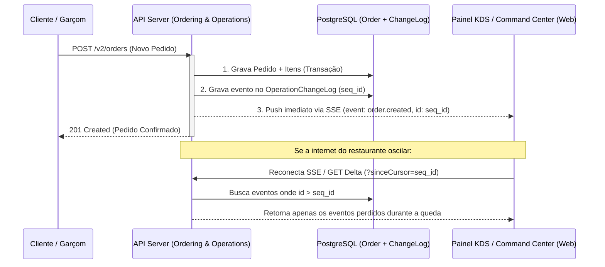

# Arquitetura de Sistemas — Ciboo (SuaVitrines Food)

Este documento detalha a arquitetura de software dos dois repositórios principais da plataforma **Ciboo**: o backend transacional (`suavitrines-api`) e a aplicação web multi-portal (`suavitrines-web`).

---

## 1. Visão Macro e Separação de Processos

O backend é estruturado como um **Monólito Modular Orientado a Domínio** com separação clara entre o tráfego HTTP síncrono e o processamento de tarefas assíncronas em segundo plano. Essa abordagem entrega a simplicidade operacional de um único artefato de deploy (Docker image) com a capacidade de escalar horizontalmente três tipos de processos independentes:

1. **API HTTP Server (`src/server.ts`)**: Atende requisições REST dos clientes finais, lojistas, garçons, entregadores, conexões SSE em tempo real e recepção rápida de webhooks externos.
2. **Transactional Outbox Worker (`src/worker.ts`)**: Processo dedicado que consome eventos gravados transacionalmente no banco de dados (envio de e-mails, notificações de status ao iFood, sincronização de catálogo, disparos de CRM) usando *optimistic lease locking* e *exponential backoff*.
3. **Distributed Scheduler (`src/scheduler.ts`)**: Agendador de rotinas periódicas (expurgo de chaves de idempotência vencidas, desativação automática de assinaturas expiradas e alertas preventivos de renovação) protegido por **locks distribuídos** no PostgreSQL para evitar execuções duplicadas em múltiplas instâncias.

---

## 2. Organização Interna do Backend (`suavitrines-api`)

O projeto combina a clareza do **MVC** na borda HTTP com **Módulos de Domínio Ricos** no núcleo da aplicação:

- **`src/routes/`**: Definição de rotas separadas por domínio e agregadas exclusivamente em `src/routes/index.ts`.
- **`src/middlewares/`**: Camada de proteção transversal contendo:
  - `requestContext`: Geração de `requestId`, rastreio de correlação e medição de latência.
  - `auth.middleware` & `customerAuth.middleware`: Validação de sessões via cookies `HTTP-Only`.
  - `authorization.middleware`: Controle de acesso baseado em papéis (`SUPER_ADMIN`, `ADMIN`, `MANAGER`, `CASHIER`, `KITCHEN`, `ATTENDANT`, `DELIVERYMAN`).
  - `csrfProtection`: Proteção contra falsificação de requisições entre sites em mutações autenticadas por cookie.
  - `idempotency.middleware`: Prevenção de duplicidade em operações críticas (checkout, pagamentos, movimentação financeira).
  - `validateRequest`: Validação declarativa de `body`, `query` e `params` com schemas **Zod**.
- **`src/controllers/`**: Orquestram a entrada/saída HTTP e garantem o retorno no envelope padronizado `{ success, data, error }`.
- **`src/modules/`**: Onde reside a inteligência de negócio isolada de detalhes de protocolo HTTP:
  - `ordering/`: Máquina de estados de pedidos, aritmética monetária em centavos e tokens seguros de rastreio.
  - `operations/`: Stream de eventos em tempo real (SSE), gerenciamento de praças/estações KDS e `OperationChangeLog`.
  - `inventory/`: Controle de estoque, fichas técnicas (receitas), reservas de insumos e cálculo de custo (CMV).
  - `cash/` & `finance/`: Abertura/fechamento de turnos de caixa, sangrias, suprimentos, despesas e conciliação financeira.
  - `payments/`: Abstração de provedores de pagamento (PSP), webhooks idempotentes e reconciliação.
  - `catalog/`: Gestão de catálogo multicanal (vitrine própria, salão e marketplaces), comparação de diffs e precificação específica por canal.
  - `engagement/` & `loyalty/`: CRM, segmentação de clientes, campanhas, gestão de consentimento LGPD e livro-razão (*ledger*) de pontos de fidelidade.
  - `integrations/ifood/`: Ingestão de webhooks, outbound de confirmação/despacho e cofres criptografados de credenciais por loja.
  - `reports/`: Agregações analíticas e relatórios executivos.

---

## 3. Arquitetura de Tempo Real (KDS & Live Command Center)

Em uma cozinha profissional ou balcão de restaurante em horário de pico, atrasos ou perdas de atualização de pedidos geram gargalos operacionais imediatos. O Ciboo implementa uma arquitetura de tempo real híbrida e tolerante a falhas:

- **Baixo Consumo de Recursos**: O uso de *Server-Sent Events (SSE)* sobre HTTP padrão evita a complexidade de clusters WebSocket dedicados e atravessa firewalls e proxies corporativos sem fricção.
- **Reconciliação por Cursor**: Toda mutação operacional gera um registro sequencial no `OperationChangeLog`. Quando o cliente web reconecta após uma instabilidade de rede, o hook `useRealtimeOperations` solicita apenas as mudanças ocorridas desde o último cursor conhecido, garantindo consistência eventual imediata sem recarregar a tela inteira.

---

## 4. Arquitetura do Frontend (`suavitrines-web`)

Construído sobre o **Next.js 16 (App Router)** e **React 19**, o frontend divide a aplicação em **Route Groups** independentes, otimizando o bundle e a estratégia de renderização para cada jornada:

| Route Group | Público-Alvo | Estratégia de Renderização |
| :--- | :--- | :--- |
| `src/app/(shop)/[slug]` | Cliente Final do Restaurante | **SSR Dinâmico + Client Interactivity**: Metadados OpenGraph/SEO gerados no servidor por loja (`[slug]`) para compartilhamento rico no WhatsApp/Instagram, combinado com carrinho reativo e checkout rápido no cliente. |
| `src/app/(admin)/admin/*` | Gestor, Caixa e Cozinha | **SPA Protegida por RBAC**: Interfaces densas e altamente interativas (Command Center, KDS, Estoque, Financeiro, Cardápio) protegidas por `AuthProvider` e `AdminRbacGuard`. |
| `src/app/(admin)/super-admin/*` | Operador do SaaS (Super Admin) | **Painel de Governança Multi-Tenant**: Controle global de lojas, ciclo de vida de assinaturas e ativação granular de *Feature Flags*. |
| `src/app/(admin)/print/*` | Impressoras Térmicas | **Layout Minimalista de Impressão**: Estilização CSS `@media print` calibrada para bobinas térmicas de 58mm e 80mm. |
| `src/app/(attendants)/service` | Garçons (Salão) | **Mobile-First Operacional**: Interface ágil otimizada para uso com uma mão no salão para abertura de mesas e lançamento de comandas. |
| `src/app/(deliveryman)/delivery` | Entregadores | **Mobile-First Logístico**: Visualização de entregas atribuídas, endereços e confirmação de entrega mediante PIN de segurança. |
