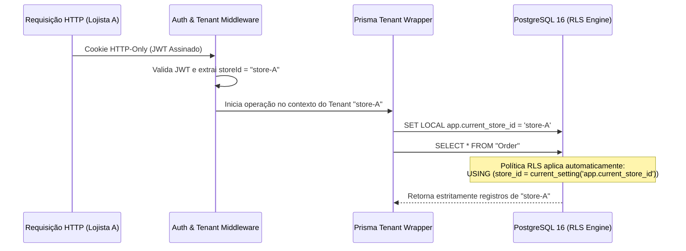

# Segurança Defensiva & Isolamento Multi-Tenant

A plataforma **Ciboo** foi projetada desde a fundação sob os princípios de **Zero Trust** e **Defesa em Profundidade (Defense-in-Depth)**, garantindo que múltiplos restaurantes operem sobre a mesma infraestrutura compartilhada com isolamento estrito de dados financeiros, operacionais e de clientes.

---

## 1. Isolamento Multi-Tenant em Dupla Camada

### Camada 1: Contexto de Ator na Aplicação (`ActorContext`)
- Nenhum endpoint administrativo confia em `storeId` enviado no corpo (`body`) ou parâmetros de URL para determinar a qual restaurante o operador pertence.
- O middleware de autenticação extrai o `storeId` e o `role` diretamente do token JWT assinado (armazenado em cookie `HTTP-Only`) e injeta um `ActorContext` imutável na requisição.

### Camada 2: Row-Level Security (RLS) no PostgreSQL
Para mitigar o risco humano de uma query Prisma esquecer a cláusula `where: { storeId }`, o banco de dados PostgreSQL possui políticas nativas de **Row-Level Security (RLS)** ativadas nas tabelas multi-tenant:

---

## 2. Autenticação Segura via Cookies HTTP-Only & Proteção CSRF

Seguindo as melhores práticas da OWASP contra ataques de *Cross-Site Scripting (XSS)*:

- **Zero JWT em `localStorage`**: Tokens administrativos e operacionais **nunca** são expostos ao JavaScript do navegador via `localStorage` ou `sessionStorage`.
- **Cookies `HTTP-Only`, `Secure` e `SameSite`**: Na autenticação (`/auth/login`), o servidor emite cookies com a flag `HttpOnly`, impedindo que qualquer script malicioso de terceiros leia a credencial de sessão.
- **Proteção CSRF**: Todas as rotas de mutação (`POST`, `PUT`, `PATCH`, `DELETE`) autenticadas via cookie passam por validação de origem e token/header anti-CSRF (`src/middlewares/csrfProtection.ts`).
- **Segregação de Segredos Criptográficos**: Sessões de operadores de restaurantes (`JWT_SECRET`) e sessões de clientes finais da vitrine (`CUSTOMER_JWT_SECRET`) utilizam chaves de assinatura independentes.

---

## 3. Controle de Acesso Baseado em Papéis (RBAC)

A autorização é aplicada tanto na **camada de serviço/API** quanto na **interface do usuário (`AdminRbacGuard`)**:

| Papel (`Role`) | Escopo de Permissão |
| :--- | :--- |
| **`SUPER_ADMIN`** | Governança global do SaaS, provisionamento de lojas, gestão de assinaturas e Feature Flags. |
| **`ADMIN` / `MANAGER`** | Gestão completa da loja: configurações, cardápio, estoque, financeiro, relatórios, equipe e marketing. |
| **`CASHIER`** | Operação do Live Command Center, abertura/fechamento de turno de caixa, sangrias e recebimentos. |
| **`KITCHEN`** | Acesso restrito ao KDS (Kitchen Display System) e avanço de preparo de itens/pedidos nas estações. |
| **`ATTENDANT`** | Acesso ao portal de salão (`/service`) para abertura de mesas e lançamento de pedidos presenciais. |
| **`DELIVERYMAN`** | Acesso exclusivo ao portal de entregas (`/delivery`) e baixa de pedidos atribuídos. |

---

## 4. Cofre de Credenciais e Criptografia em Repouso

Integrações externas como o **iFood** exigem o armazenamento de tokens OAuth e credenciais de cliente por restaurante.
- Tais segredos jamais são salvos em texto puro no banco de dados.
- O módulo `src/modules/integrations/ifood/secrets.ts` utiliza criptografia simétrica autenticada (**AES-256-GCM**) com chave mestra injetada via ambiente (`IFOOD_CREDENTIAL_KEY`) e vetores de inicialização (IV) únicos por registro.

---

## 5. Proteções Adicionais de Borda e Infraestrutura

1. **Prevenção contra Manipulação de Preços no Checkout Público**:
   - O endpoint público de criação de pedidos recebe apenas os IDs dos produtos, quantidades, IDs dos complementos selecionados e código do cupom. Todo o cálculo financeiro é executado no servidor a partir dos preços vigentes no banco de dados.
2. **Tokens Criptográficos de Rastreamento de Pedido**:
   - Para evitar enumeração de pedidos públicos por ID sequencial ou UUID previsível, o acompanhamento de pedidos ao vivo utiliza tokens assinados (`trackingToken`) com escopo restrito ao pedido.
3. **Upload Seguro de Imagens**:
   - O middleware de upload não confia na extensão do arquivo ou no header `Content-Type`. Ele inspeciona os **magic bytes** reais do buffer binário via `file-type`, rejeita formatos não permitidos e reprocessa a imagem com `sharp` (convertendo para WebP otimizado e removendo metadados EXIF potencialmente maliciosos) antes de enviar ao Supabase Storage.
4. **Proteção SSRF (Server-Side Request Forgery)**:
   - O despachante de webhooks e integrações externas valida destinos de rede (`src/modules/outbox/ssrfProtection.ts`), bloqueando chamadas para faixas de IP privadas/loopback (`127.0.0.1`, `10.x.x.x`, `169.254.169.254`, `192.168.x.x`).
5. **Rate Limiting Granular**:
   - Limites de taxa diferenciados protegem rotas sensíveis (login, recuperação de senha, criação pública de pedidos e webhooks) contra força bruta e abuso automatizado.
